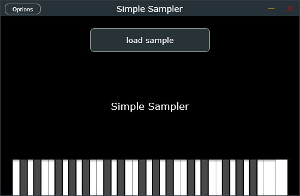

# Simple Sampler

A simple sampler plugin (VST3 + Standalone) built with C++ and JUCE.

Load an audio file, the silence at the start is trimmed automatically,
and the sample plays pitched across the keyboard. Play it with a MIDI
controller or with the on-screen keyboard.

## Features

- Load .wav, .aiff or .flac files with a button
- Automatic trimming of the initial silence
- Pitch follows the MIDI note (root note 60)
- 8 voices, sample-accurate note timing
- On-screen keyboard

## Samples

The `samples` folder contains a few short TR-808 drum sounds so the plugin can be tried right away. Run the Standalone version, click "Load sample" and pick any file from that folder. Play the notes with the on-screen keyboard.

Sample credits: the drum sounds come from the TR-808 sample archive at http://machines.hyperreal.org/manufacturers/Roland/TR-808/. No license is stated there, so please check their terms before reusing the files.

Any other `.wav`, `.aiff` or `.flac` file also works. If the sample starts with silence, the plugin skips it automatically so the sound plays right on the key press.

## Build (Windows)

Requires Visual Studio with C++ tools, CMake and Git.
JUCE is downloaded automatically with FetchContent.

1. Open the Developer Command Prompt for VS
2. cd into the project folder
3. cmake -B build
4. cmake --build build --config Release

## Known limitations

- Note off is ignored (one-shot playback, no envelope)
- The loaded sample is not saved with the DAW project
- Fixed silence threshold (-40 dB), start of the file only
- Whole file is loaded into memory

## License

Built with JUCE. Check JUCE's license terms before choosing one.